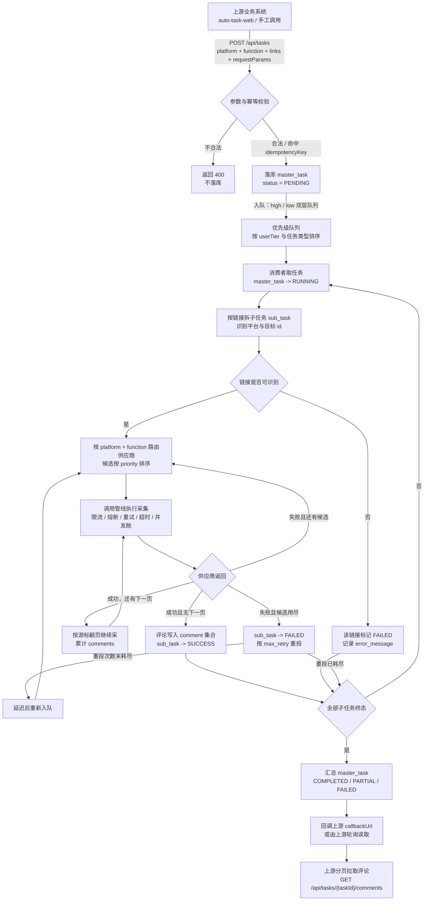
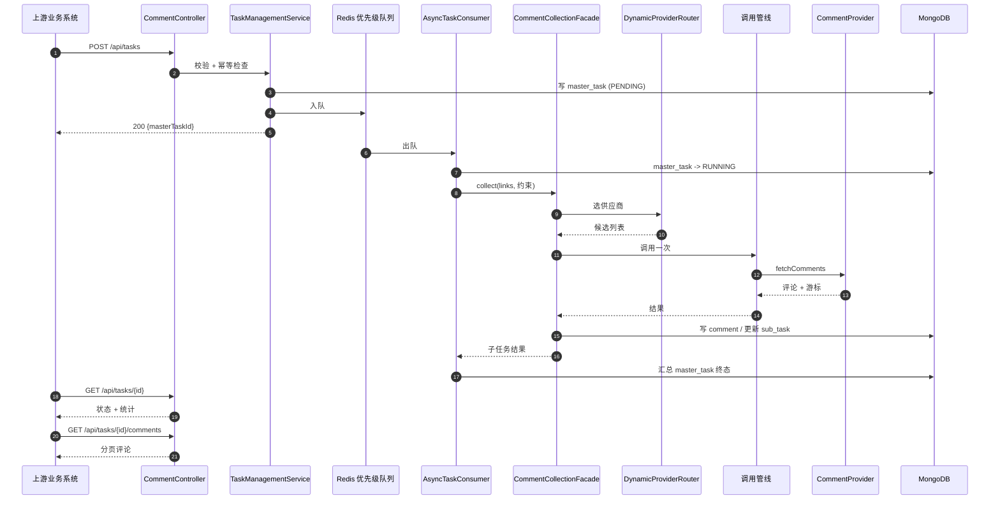
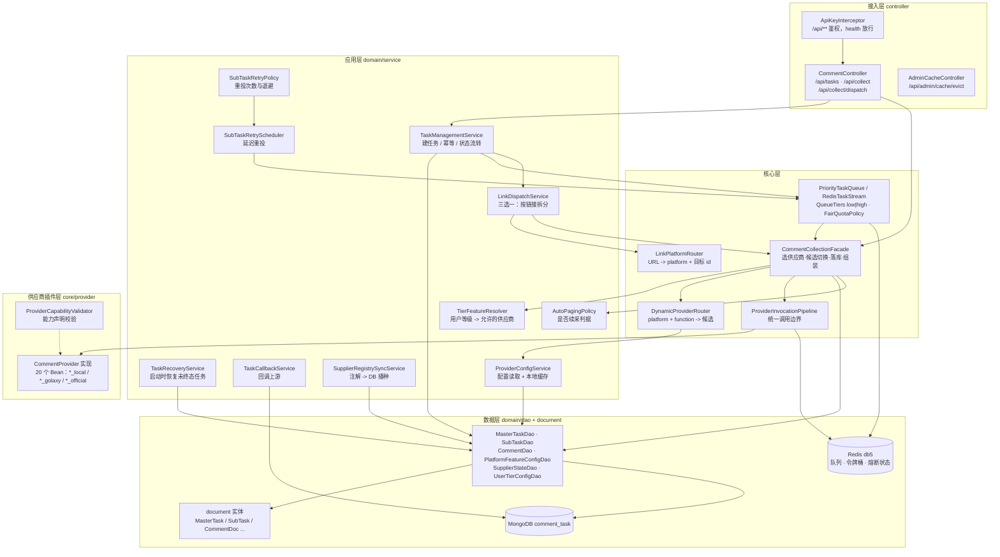
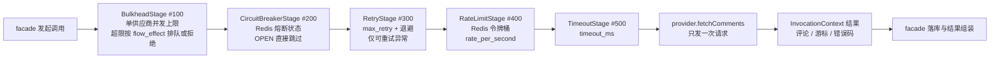
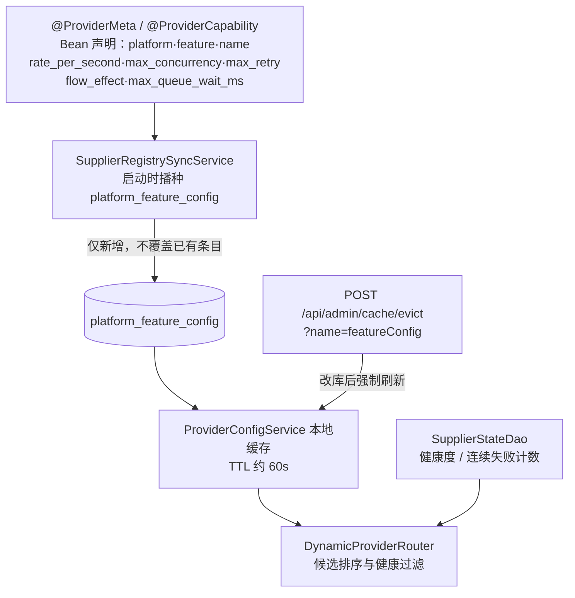

# comment-collector-service · 评论采集中间服务

多平台评论采集的**中间服务**：上游业务系统（auto-task-web 等）提交采集任务，本服务负责拆链接、选供应商、按 QPS/并发约束调用、落库并回调，屏蔽各平台接口差异与风控细节。

- 技术栈：Spring Boot 3.4.5 / Java 21 / MongoDB（`comment_task`）/ Redis（db5）
- 监听：`8075`，context-path `/comment-collector`，健康检查 `GET /comment-collector/api/health`
- 权威设计文档：[docs/评论采集中间服务-总体设计文档.md](docs/评论采集中间服务-总体设计文档.md)（当前 v3.6）

---

## 一、业务流程图

从「上游提交任务」到「评论可被上游拉取」的业务视角。异步提交立即返回 `masterTaskId`，采集在后台按队列与优先级推进；上游通过 `GET /api/tasks/{taskId}` 轮询终态、再分页拉 `GET /api/tasks/{taskId}/comments`。



### 关键业务规则

| 规则 | 说明 |
|---|---|
| 终态语义 | `COMPLETED` 全部链接成功；`PARTIAL` 部分链接成功；`FAILED` 全部失败。上游按 `totalLinks / successLinks / failedLinks` 判断 |
| 供应商约束 | 请求可带 `supplierConstraint`（如 `weibo_local`）。**硬匹配**：找不到对应 Bean 直接失败，不做模糊匹配 |
| 限流 | 每供应商独立令牌桶（Redis），`rate_per_second` 来自 `platform_feature_config`；`flow_effect=THROTTLE_QUEUE` 时超额排队等令牌，`REJECT` 时直接失败 |
| 重试 | 子任务级 `max_retry` + 退避；供应商实现只发一次请求，失败以 `status != SUCCESS` 表达 |
| 续采 | 上游按 `total - processedCount` 增量拉取；服务端游标翻页保证同一 `sub_task` 不重复产出 |
| 缓存 | 配置读取走本地缓存（TTL 约 60s），改库后需 `POST /api/admin/cache/evict?name=featureConfig` |

### 一次异步采集的时序



---

## 二、开发设计代码流程图

### 分层与调用链



### 调用管线内部顺序

固定装配顺序，编号即 order；任一层拒绝或抛错都会终止本次调用，由 facade 决定是否切下一个候选。



| 阶段 | 拒绝/失败时的行为 |
|---|---|
| Bulkhead | `THROTTLE_QUEUE` 且在 `max_queue_wait_ms` 内等到空位则继续；否则抛 `BulkheadFullException` |
| CircuitBreaker | 熔断 OPEN 抛错，facade 切下一候选 |
| Retry | 不可重试异常（如 4xx 语义）直接抛出，不消耗重试次数 |
| RateLimit | 未拿到令牌抛 `RateLimitedException`；排队超时同样如此 |
| Timeout | 超时抛 `ProviderTimeoutException`，计一次失败 |

### 配置与供应商注册链路



> 存量条目的 `rate_per_second`、`flow_effect`、`max_retry` 以数据库为唯一事实来源；注解默认值只影响**新插入**的行。因此改注解后仍需用迁移工具改库并淘汰缓存。

### 关键类索引

| 关注点 | 入口 |
|---|---|
| 接口定义 | `controller/CommentController.java` |
| 任务生命周期 | `domain/service/TaskManagementService.java` |
| 链接拆分 | `domain/service/LinkDispatchService.java`、`core/router/LinkPlatformRouter.java` |
| 候选与切换 | `facade/CommentCollectionFacade.java`、`core/router/DynamicProviderRouter.java` |
| 调用边界 | `core/pipeline/ProviderInvocationPipeline.java` 及同目录 5 个 Stage |
| 限流 | `core/ratelimit/AdaptiveRateLimiter.java`、`FlowEffect.java`、`TokenBucketMath.java` |
| 熔断 | `core/circuit/ProviderCircuitBreaker.java` |
| 队列 | `core/scheduler/PriorityTaskQueue.java`、`facade/QueueTiers.java`、`facade/RedisTaskStream.java` |
| 供应商实现 | `core/provider/**/​*Provider.java`（20 个 Bean） |
| 抖音签名 | `core/provider/douyin/sign/`（`Sm3` / `ABogusSigner` / `DouyinCookie`） |
| 数据模型 | `domain/document/`、`domain/dao/` |
| 运维工具 | `src/test/java/com/sysj/collector/tools/`（迁移/巡检工具，默认跳过） |

---

## 三、本地运行

```bash
# 依赖：JDK 21、MongoDB 27017、Redis 6379
mvn -s .mvn-settings.xml spring-boot:run
# 或直接运行 CommentCollectorServiceApplication

curl http://127.0.0.1:8075/comment-collector/api/health
```

`/api/tasks`、`/api/collect` 等业务接口需要 API Key（`ApiKeyInterceptor`），`/api/health` 放行。

---

## 四、文档导航

| 文档 | 内容 |
|---|---|
| [总体设计文档](docs/评论采集中间服务-总体设计文档.md) | 唯一权威：需求、架构、数据模型、接口、缺陷登记、演进计划（v3.6） |
| [接口使用文档](docs/评论采集中间服务-接口使用文档.md) | 调用方接入说明与字段定义 |
| [Linux 部署运维文档](docs/评论采集中间服务-Linux部署运维文档.md) | 部署、配置、排障 |
| [压测与容量基线方案](docs/评论采集中间服务-压测与容量基线方案.md) | 容量评估与压测方法 |

---

## 附：历史文档归档说明（2026-09-23）

`docs/archive/` 存放**已被取代**的历史文档，仅作追溯用途，**请勿据此开发**。

| 文件 | 原路径 | 被取代原因 |
|---|---|---|
| `docs/archive/2026-09-23/多平台数据采集中间服务-需求文档-v1.1.md` | `docs/requirements/` | 内容已并入总设文档 §3 需求基线 |
| `docs/archive/2026-09-23/评论中间服务-需求文档-v1.1.md` | `docs/requirements/` | 同上 |
| `docs/archive/2026-09-23/2026-07-19-设计文档-v1.1.md` | `docs/superpowers/specs/` | 内容已并入总设文档 §4~§9 |
| `docs/archive/2026-09-23/2026-09-23-缺陷清单与修复计划.md` | `docs/plans/` | 内容已并入总设文档 §16 缺陷登记表 与 §17 演进计划 |

原始 Word 文档（`多平台数据采集中间服务开发需求文档.docx`、`评论中间服务.doc`）保留在仓库根目录未修改；后者实为纯 UTF-8 文本。
